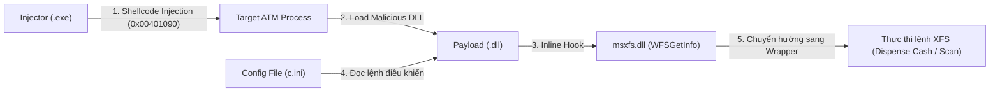

Q1: tiến trình mà bị tiêm file .dll độc hại vào

Q2: sau khi bị tiêm, tiến trình chạy lên và đọc file .ini để biết nó sẽ làm gì (kết nối C2 nào, thực hiện hành vi gì)

Q3: tên thư viện ban đầu được đặt tên mã nguồn file .exe để từ đó khi thực thi file .exe thì nó sẽ gọi đúng thư viện .dll

Q4: Việc xác định địa chỉ hàm nơi chứa shellcode giúp theo dõi luồng thực thi của mã độc. Địa chỉ nằm bên trong file .exe chứa đoạn shellcode chịu trách nhiệm load và unload file DLL độc hại

Q5: thư viện cung cấp API để tương tác với máy ATM

Q6: 

Q7,8:

## 1. Tổng quan (Overview)
**ATMii** là một dòng mã độc chuyên nhắm vào các máy rút tiền tự động (**ATM**) chạy hệ điều hành Windows và sử dụng chuẩn giao tiếp tài chính **CEN/XFS (Extensions for Financial Services)**. Mục tiêu chính của mã độc là can thiệp vào luồng hoạt động của phần mềm quản lý ATM để buộc hộc chứa tiền (Cash Dispenser) nhả toàn bộ tiền mặt theo lệnh của kẻ tấn công.

Mẫu mã độc bao gồm **2 thành phần chính**:
1. **Injector (`exe`)**: Công cụ dòng lệnh có nhiệm vụ tìm tiến trình điều khiển ATM và tiêm (inject) hoặc gỡ (unload) thư viện độc hại.
2. **Payload (`dll`)**: Thư viện độc hại chứa logic chính, thực hiện kỹ thuật **API Hooking** vào thư viện XFS (`msxfs.dll`) và nhận lệnh điều khiển thông qua tệp cấu hình cục bộ.

---

## 2. Chuỗi hành vi kỹ thuật (Technical Behavior & Execution Flow)

### Giai đoạn 1: Tiêm mã độc vào tiến trình mục tiêu (Process Injection)
* **Xác định mục tiêu**: File Injector tìm kiếm tiến trình quản lý dịch vụ ATM đang chạy trên hệ thống để lấy `Process Handle`.
* **Cấp phát và ghi bộ nhớ (`VirtualAllocEx` & `WriteProcessMemory`)**:
  * Thay vì gọi trực tiếp `LoadLibrary` qua `CreateRemoteThread`, Injector sử dụng một hàm **Shellcode nội bộ** tại địa chỉ **`0x00401090`**.
  * Injector cấp phát **2 vùng nhớ** bên trong tiến trình mục tiêu:
    1. Một vùng nhớ chứa **đoạn Shellcode (`0x00401090`)**.
    2. Một vùng nhớ chứa **cấu trúc tham số (Parameters)** bao gồm: cờ điều khiển (Load/Unload), đường dẫn file DLL, và địa chỉ các hàm API (`LoadLibraryW`, `FreeLibrary`, `GetLastError`).
* **Thực thi và xóa dấu vết**:
  * Gọi `CreateRemoteThread` để kích hoạt Shellcode nạp file DLL độc hại (hoặc gọi `FreeLibrary` để gỡ DLL khi kết thúc cuộc tấn công).
  * Giải phóng vùng nhớ đã cấp phát bằng `VirtualFreeEx` để tránh bị phát hiện.

### Giai đoạn 2: Đặt bẫy hàm API tài chính (XFS API Hooking)
* Khi file DLL độc hại được nạp vào tiến trình ATM, hàm `SetHooks` (`0x10002880`) sẽ tìm mô-đun **`msxfs.dll`** (Microsoft XFS Manager).
* Mã độc lấy địa chỉ của hàm API gốc **`WFSGetInfo`** thông qua `GetProcAddress`.
* Thực hiện **Inline Hook** lên hàm **`WFSGetInfo`**, chuyển hướng mọi lời gọi hàm này sang một **hàm bọc (Wrapper function)** do mã độc kiểm soát.
* **Lý do chọn `WFSGetInfo`**: Đây là hàm được phần mềm ATM gọi liên tục để kiểm tra trạng thái thiết bị. Nhờ hook hàm này, mã độc vừa lấy được `hService` (Service Handle của hộc đựng tiền) hợp lệ mà không cần tự khởi tạo phiên kết nối mới, vừa có thể kích hoạt lệnh bất cứ lúc nào.

### Giai đoạn 3: Nhận lệnh từ tệp cấu hình và Nhả tiền (Command & Cash-out)
* Mỗi khi hàm `WFSGetInfo` bị gọi và nhảy vào hàm Wrapper, mã độc sẽ kiểm tra và đọc các tham số điều khiển từ tệp cấu hình **`c.ini`**.
* Tùy thuộc vào lệnh cấu hình trong tệp **`c.ini`**, mã độc sẽ:
  * Quét thông tin các hộc chứa tiền (Cassettes) để biết mệnh giá và số lượng tờ tiền còn lại.
  * Gọi hàm `WFSExecute` với mã lệnh **`WFS_CMD_CDM_DISPENSE`** để ra lệnh cho phần cứng ATM nhả tiền mặt ra ngoài.

---

## 3. Tóm tắt các chỉ số quan trọng (Key Artifacts / IOCs)
| Thành phần | Giá trị / Chi tiết |
| :--- | :--- |
| **Kỹ thuật Injection** | Shellcode-based DLL Injection (`WriteProcessMemory` + `CreateRemoteThread`) |
| **Địa chỉ hàm Shellcode** | `0x00401090` |
| **Thư viện mục tiêu bị can thiệp** | `msxfs.dll` (CEN/XFS Manager) |
| **Hàm API gốc bị Hook** | `WFSGetInfo` |
| **Tệp cấu hình nhận lệnh** | `c.ini` |

