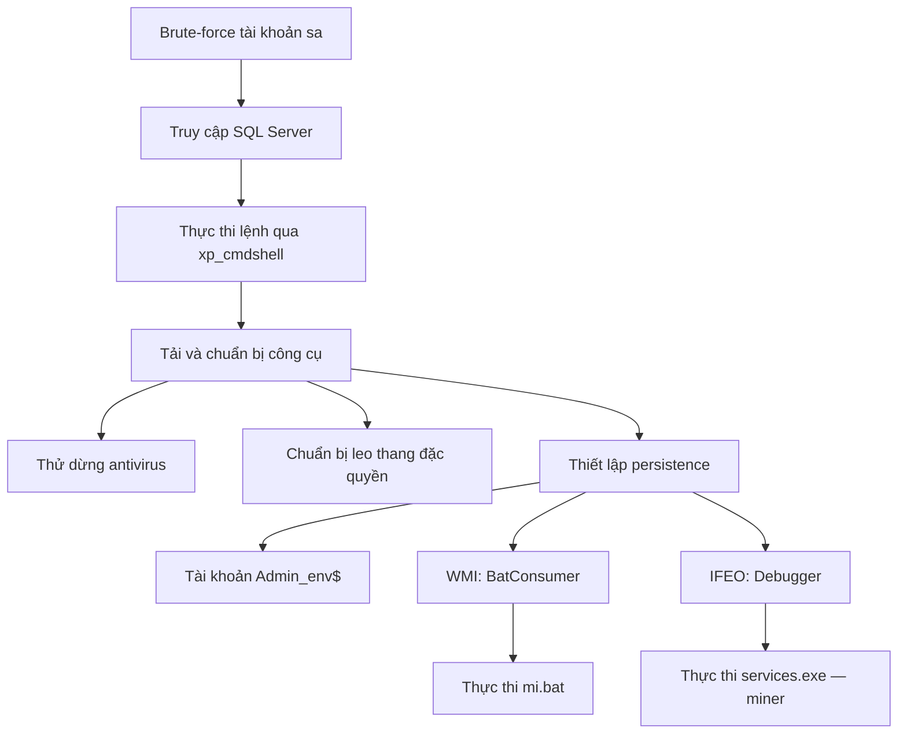

Q1: xem các app như là SQL -> application.evxt với event id 18456 là đăng nhập thất bại

Q2: event id 18456 là khi đăng nhập thành công

Q5: event id 15457 là khi cấu hỉnh bị thay đổi

# MinerHunt — Phân tích chuỗi tấn công

## 1. Tổng quan

Attacker bắt đầu bằng việc brute-force tài khoản quản trị SQL Server `sa`. Sau khi truy cập thành công, attacker sử dụng `xp_cmdshell` để thực thi lệnh Windows, tải công cụ, thay đổi cấu hình hệ thống và thiết lập persistence.

Mục tiêu cuối là triển khai **XMRig**, sử dụng tài nguyên của máy chủ bị xâm nhập để đào tiền mã hóa.

Đây là một chuỗi tấn công gồm nhiều công cụ và script; không phải mọi hành vi đều do riêng file miner thực hiện.



## 2. Brute-force tài khoản SQL Server

Attacker sử dụng IP:

```text
3.79.210.175
```

IP này thực hiện nhiều lần đăng nhập thất bại nhắm tới tài khoản `sa`, phù hợp với kỹ thuật **Brute Force — T1110**.

Mốc đăng nhập thành công cuối được walkthrough ghi nhận:

```text
2025-03-09 11:32:51 UTC
```

### Dấu vết cần kiểm tra

File log:

```text
Application.evtx
```

| Event ID | Ý nghĩa trong bài |
|---|---|
| 18456 | Đăng nhập SQL Server thất bại |
| 18454 | Sự kiện đăng nhập thành công được sử dụng trong bài |

Khi phân tích, đối chiếu tên tài khoản, IP nguồn, số lần thất bại và thời gian đăng nhập thành công.

> `sa` là tài khoản quản trị SQL Server. Quyền quản trị SQL không tự động đồng nghĩa với quyền `SYSTEM` trên Windows.

## 3. Thực thi lệnh Windows qua xp_cmdshell

Attacker thay đổi cấu hình SQL Server để sử dụng `xp_cmdshell`, từ đó thực thi lệnh hệ điều hành thông qua phiên SQL.

Mốc thay đổi cấu hình được ghi nhận:

```text
2025-03-09 11:40 UTC
```

Tiến trình cha liên quan:

```text
PID: 6868
```

Command line:

```text
"C:\Program Files\Microsoft SQL Server\MSSQL15.MSSQLSERVER\MSSQL\Binn\sqlservr.exe" -sMSSQLSERVER
```

### Dấu vết cần kiểm tra

- **Application Event ID 15457:** thay đổi cấu hình SQL Server.
- **Sysmon Event ID 1:** tạo tiến trình.
- Các trường quan trọng: `ParentImage`, `ParentProcessId`, `Image` và `CommandLine`.

Điểm cần chú ý là các lệnh hệ điều hành đáng ngờ xuất phát từ `sqlservr.exe`.

**MITRE ATT&CK:** `T1059.003 — Windows Command Shell`.

## 4. Tải và chuẩn bị công cụ

Attacker sử dụng PowerShell để tải file từ:

```text
18.184.228.195
```

Các thành phần được mô tả trong walkthrough:

| File | Vai trò |
|---|---|
| `xx.exe` | Công cụ giải nén 7-Zip được đổi tên |
| `XeX.7z` | Gói nén chứa các thành phần triển khai |
| `FM.txt` | File mã hóa, được giải mã thành `FM.exe` |
| `NF.bmof` | Thành phần dùng thiết lập WMI persistence |

Lệnh giải nén được ghi nhận:

```text
C:\Users\Public\xx.exe  x C:\Users\Public\XeX.7z -oC:\Users\Public -y
```

Attacker cũng sử dụng `certutil -decode` để chuyển `FM.txt` thành `FM.exe`.

Công cụ leo thang đặc quyền được bài xác định là:

```text
https://github.com/decoder-it/NetworkServiceExploit
```

> Nhận diện hoặc thấy công cụ được thực thi chưa đủ để kết luận leo thang đặc quyền thành công. Cần đối chiếu tài khoản và quyền của các tiến trình tiếp theo.

## 5. Thử dừng antivirus

Attacker thực thi hàng loạt lệnh `taskkill` nhắm tới các tiến trình antivirus.

Mục tiêu đầu tiên:

```text
avp.exe
```

Đây là tiến trình thuộc **Kaspersky**.

### Dấu vết cần kiểm tra

Trong **Sysmon Event ID 1**, tìm:

```text
taskkill
avp.exe
```

Nếu nhiều lệnh có timestamp gần nhau, kiểm tra thêm thứ tự bản ghi để xác định mục tiêu đầu tiên.

> Sự tồn tại của lệnh `taskkill` chứng minh hành vi cố dừng antivirus, không tự chứng minh antivirus đã bị dừng thành công.

## 6. Tạo tài khoản và thay đổi cấu hình hệ thống

Attacker tạo batch file:

```text
C:\Users\Public\N1F10.bat
```

File này chứa các thao tác phục vụ duy trì truy cập và thay đổi bảo mật hệ thống:

- Tạo tài khoản `Admin_env$`.
- Thêm tài khoản vào nhóm Administrators.
- Sửa registry nhằm ẩn tài khoản khỏi màn hình đăng nhập.
- Bật Remote Desktop.
- Nới lỏng một số thiết lập truy cập từ xa.
- Thay đổi cấu hình WDigest để tạo điều kiện thu thập thông tin xác thực.

### 6.1. Ẩn tài khoản

Registry key được sử dụng:

```text
HKLM\SOFTWARE\Microsoft\Windows NT\CurrentVersion\Winlogon\SpecialAccounts\Userlist
```

Giá trị mang tên tài khoản `Admin_env$` được đặt thành `0`, nhằm ẩn tài khoản khỏi màn hình đăng nhập.

### 6.2. Thay đổi WDigest

Lệnh được ghi nhận:

```text
reg add "HKLM\SYSTEM\CurrentControlSet\Control\SecurityProviders\WDigest" /v UseLogonCredential /t REG_DWORD /d 1 /f
```

Mục đích là tạo điều kiện để thông tin xác thực dạng rõ được lưu trong bộ nhớ, phục vụ hành vi đánh cắp thông tin xác thực sau đó.

> Việc sửa registry WDigest chưa đủ để kết luận mật khẩu đã được trích xuất.

## 7. Thiết lập persistence

Attacker triển khai nhiều cơ chế nhằm duy trì khả năng thực thi mã và truy cập hệ thống.

### 7.1. WMI event subscription

Các thành phần liên quan:

| Thành phần | Giá trị |
|---|---|
| BMOF file | `NF.bmof` |
| WMI consumer | `BatConsumer` |
| File được gọi | `C:\Users\Public\XeX\mi.bat` |

Consumer được gắn với điều kiện sự kiện WMI; khi điều kiện tương ứng xảy ra, hành động đã cấu hình có thể được thực thi.

Các Sysmon Event ID cần kiểm tra:

| Event ID | Dấu vết |
|---|---|
| 19 | WMI event filter |
| 20 | WMI event consumer |
| 21 | Liên kết consumer với filter |

Đối chiếu các sự kiện này với sự kiện tạo tiến trình để xác định hành động đã thực sự được kích hoạt hay chưa.

### 7.2. Image File Execution Options — Debugger

Attacker thêm giá trị `Debugger` tại registry key:

```text
HKLM\SOFTWARE\Microsoft\Windows NT\CurrentVersion\Image File Execution Options\svchost.exe
```

Dữ liệu của giá trị `Debugger`:

```text
C:\Users\Public\XeX\services.exe
```

Cơ chế này can thiệp việc khởi chạy chương trình thông qua Image File Execution Options, nhằm đưa executable của attacker vào quá trình thực thi.

Cần phân biệt:

- **Registry key:** kết thúc ở `svchost.exe`.
- **Value name:** `Debugger`.
- **Value data:** đường dẫn đến `services.exe`.

Dấu vết có thể được đối chiếu trong **Sysmon Event ID 13** và các lệnh sửa registry ở **Event ID 1**.

## 8. Triển khai miner

File được xác định là miner:

```text
C:\Users\Public\XeX\services.exe
```

Walkthrough nhận diện executable này là **XMRig**.

MD5:

```text
F6D520AE125F03056C4646C508218D16
```

Tên `services.exe` dễ gây nhầm với tiến trình Windows. Vì vậy, khi phân tích cần kiểm tra đồng thời:

- Đường dẫn executable.
- Hash của file.
- Tiến trình cha.
- Command line.
- Các cơ chế persistence gọi tới file.

Mục tiêu cuối của chiến dịch là sử dụng tài nguyên máy chủ bị chiếm để đào tiền mã hóa.

## 9. IOC chính

| Loại | Giá trị | Ngữ cảnh |
|---|---|---|
| IP | `3.79.210.175` | Truy cập SQL Server |
| IP | `18.184.228.195` | Phân phối file |
| Tài khoản SQL | `sa` | Mục tiêu brute-force |
| Tài khoản Windows | `Admin_env$` | Duy trì truy cập |
| Batch file | `C:\Users\Public\N1F10.bat` | Thay đổi tài khoản và cấu hình |
| Encoded file | `C:\Temp\FM.txt` | Được giải mã thành executable |
| WMI file | `NF.bmof` | Thiết lập WMI persistence |
| WMI consumer | `BatConsumer` | Gọi script đã cấu hình |
| Batch file | `C:\Users\Public\XeX\mi.bat` | Được WMI consumer gọi |
| Miner | `C:\Users\Public\XeX\services.exe` | XMRig |
| MD5 | `F6D520AE125F03056C4646C508218D16` | Hash của miner |

## 10. Hướng dựng timeline

1. Tìm các lần đăng nhập SQL Server thất bại trong `Application.evtx`.
2. Xác định đăng nhập thành công từ IP liên quan.
3. Tìm thay đổi cấu hình `xp_cmdshell`.
4. Theo dõi tiến trình con của `sqlservr.exe` trong Sysmon.
5. Liên kết các lệnh tải file, giải mã và giải nén.
6. Kiểm tra hành vi dừng antivirus, tạo tài khoản và sửa registry.
7. Đối chiếu WMI subscription và IFEO Debugger.
8. Xác định thời điểm miner được thực thi.

Khi dựng timeline, chuẩn hóa múi giờ và kiểm tra timestamp gốc. Phân biệt rõ hành vi **cố thực hiện**, **đã thực thi** và **đã xác nhận thành công**.
